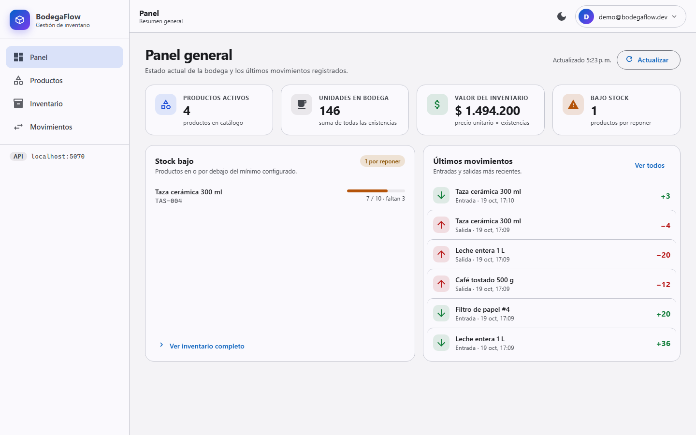
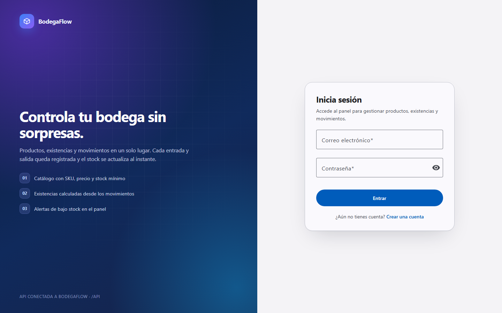
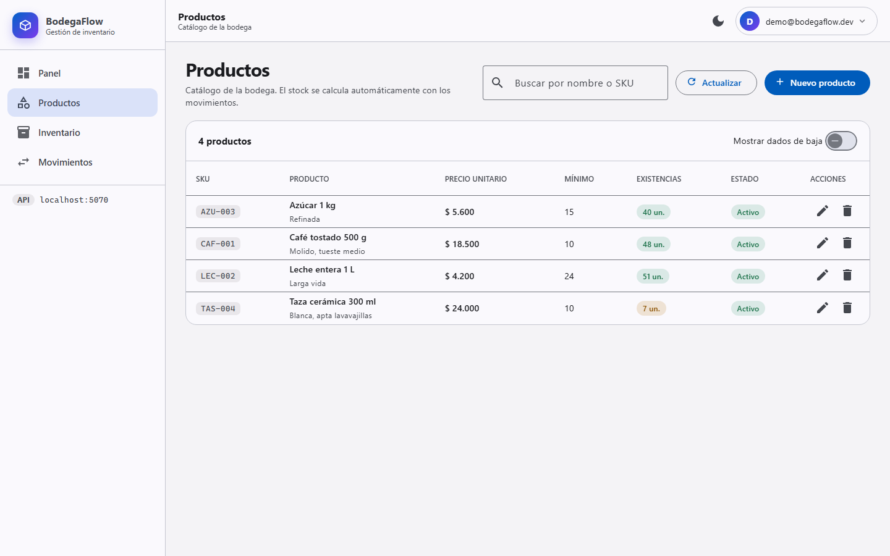
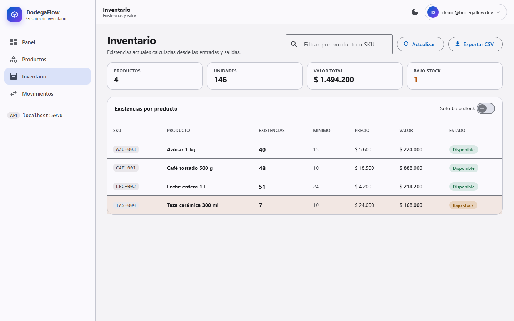
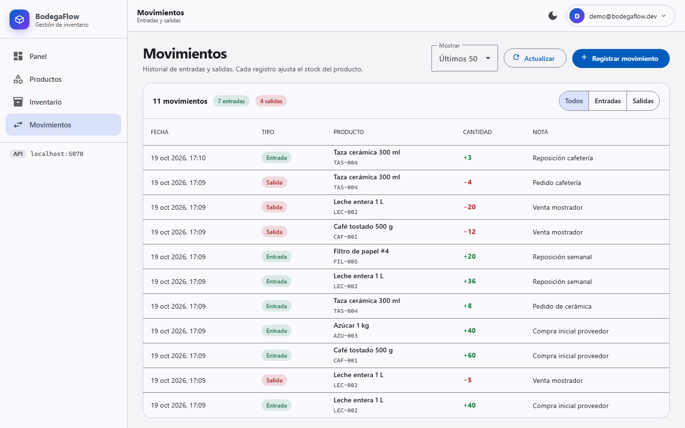
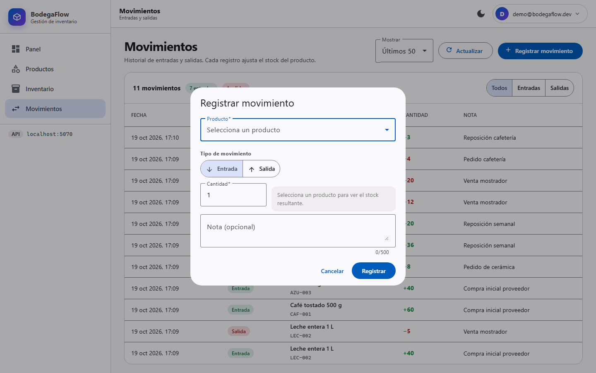
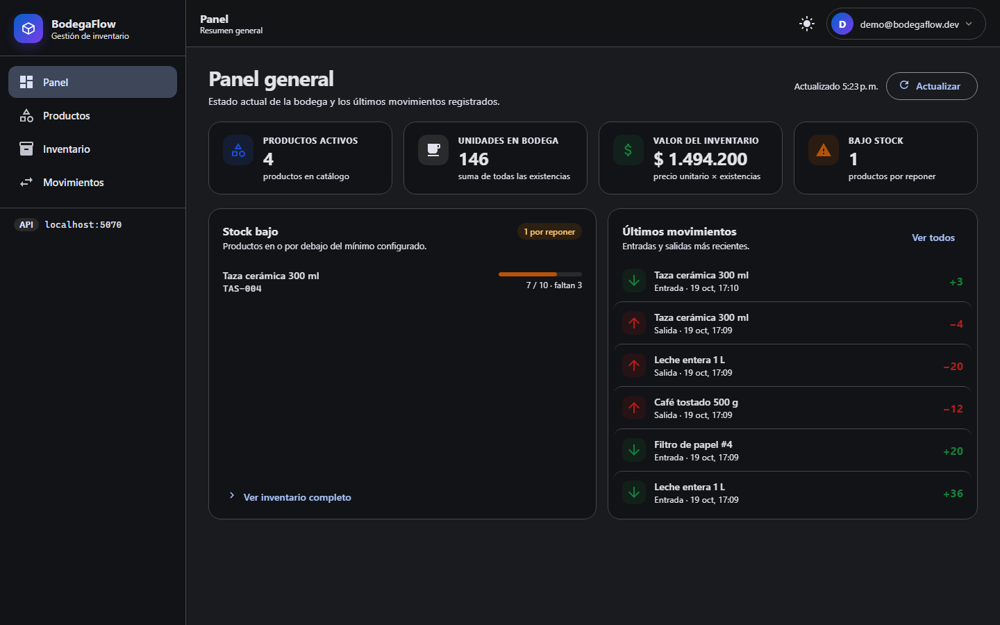
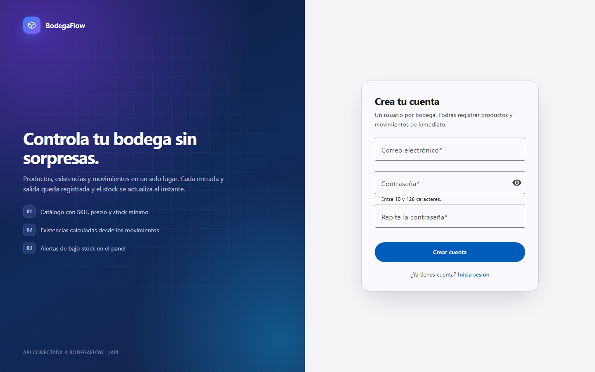
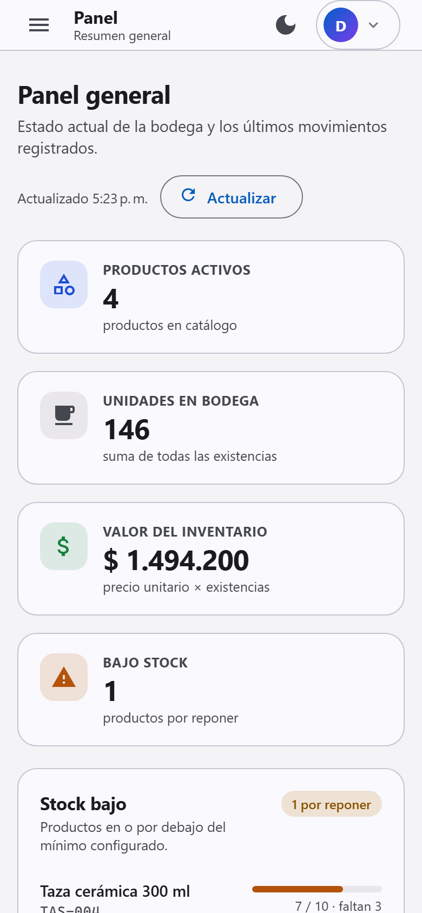

# BodegaFlow · Front-end de inventario

Aplicación Angular 22 + Angular Material 3 para gestionar el inventario que expone la API
**BodegaFlow** (`http://localhost:5070/swagger/index.html`): autenticación, catálogo de productos,
existencias calculadas por movimientos y panel de control.



## Funcionalidad

| Vista | Qué permite |
| --- | --- |
| **Acceso** (`/login`, `/registro`) | Inicio de sesión con JWT, creación de cuenta con validaciones y aviso de credenciales incorrectas. |
| **Panel** (`/dashboard`) | Indicadores (productos activos, unidades, valor del inventario, bajo stock), productos por reponer y últimos movimientos. |
| **Productos** (`/productos`) | Búsqueda contra el API, alta y edición en diálogo, baja lógica con confirmación, existencias junto a cada producto. |
| **Inventario** (`/inventario`) | Existencias por producto, filtro «solo bajo stock», totales y exportación a CSV. |
| **Movimientos** (`/movimientos`) | Historial con filtros por tipo, registro de entradas/salidas con vista previa del stock resultante. |

Detalles transversales:

- **Sesión**: token JWT en `localStorage`, interceptor que lo adjunta y cierra la sesión ante un `401`,
  guardas de ruta (`authGuard`, `guestGuard`) y retorno a la URL solicitada.
- **Errores del API**: `ProblemDetails` traducidos a mensajes en español (`api-error.ts`), tanto de validación
  por campo como de conflicto o error interno.
- **Tema**: Material 3 con paletas `azure`/`violet`, modo claro y oscuro persistido en el navegador.
- **Iconografía propia**: los iconos son SVG incluidos en el bundle, sin depender de Google Fonts.
- **Zoneless**: sin `zone.js`; estado con signals y `computed` en todas las vistas.
- **Formato**: locale `es-CO` y moneda `COP` (`$ 18.500`).

## Requisitos

- Node.js 20+ (probado con 24) y npm o bun.
- La API **BodegaFlow** en marcha en `http://localhost:5070` (ver la sección *Backend*).

## Puesta en marcha

```bash
npm install          # o: bun install
npm start            # ng serve, con proxy /api -> http://localhost:5070
```

La aplicación queda en **http://localhost:4200**. Desde la carpeta raíz `bodegapp` puedes arrancar
los dos proyectos a la vez con `.\dev.ps1`.

Credenciales de demostración ya sembradas en la base local:

```
correo:    demo@bodegaflow.dev
contraseña: BodegaFlow2026!
```

> El proxy de desarrollo está en [`proxy.conf.json`](proxy.conf.json) y se aplica desde
> `angular.json` (`serve.options.proxyConfig`), por lo que no hay CORS de por medio.
> El API también tiene `http://localhost:4200` habilitado en su lista de orígenes.

### Scripts

| Comando | Descripción |
| --- | --- |
| `npm start` | Servidor de desarrollo con proxy al API. |
| `npm run build` | Compilación de producción en `dist/inventario-front-end`. |
| `npm test` | Pruebas unitarias con Vitest (añadir `-- --watch=false` para una sola pasada). |

## Estructura

```
src/app
├── app.config.ts            Proveedores: router, HttpClient + interceptores, locale es-CO, Material
├── app.routes.ts            Rutas con carga diferida y guardas
├── core
│   ├── api/                 API_BASE, traducción de errores ProblemDetails
│   ├── icons/               Set de iconos SVG y registro en MatIconRegistry
│   ├── interceptors/        authInterceptor (Bearer + 401)
│   ├── guards/              authGuard y guestGuard
│   ├── models/              Contratos del API (productos, inventario, movimientos, auth)
│   └── services/            Auth, Product, Inventory, Movement, Theme, Notification
├── layout/shell             Estructura con sidenav, barra superior, menú de cuenta y tema
├── features
│   ├── auth/                auth-shell compartido, login y registro
│   ├── dashboard/           Panel con indicadores
│   ├── products/            Listado + diálogo de alta/edición
│   ├── inventory/           Existencias y exportación CSV
│   ├── movements/           Historial + diálogo de registro
│   └── not-found/           Página 404
└── shared/ui                EmptyState y ConfirmDialog reutilizables
```

## Contrato del API utilizado

`GET /api/health`, `POST /api/auth/register`, `POST /api/auth/login`, `GET /api/auth/me`,
`GET /api/dashboard`, `GET|POST /api/products`, `PUT|DELETE /api/products/{id}`,
`GET /api/inventory`, `GET|POST /api/movements?limit=`.

Notas relevantes descubiertas al integrar:

- El enumerado `MovementType` viaja como texto (`"Entry"` / `"Exit"`), no como número.
- `DELETE /api/products/{id}` es **baja lógica** (`isActive = false`); el API no expone reactivación.
- `GET /api/inventory` y `GET /api/dashboard` solo consideran productos activos, mientras que
  `GET /api/products` devuelve también los inactivos (la vista los oculta salvo que se pidan).
- Las entradas y salidas se validan en PostgreSQL (transacción + `FOR UPDATE`), por lo que una salida
  mayor que el stock responde `400` con el mensaje «Existencias insuficientes para realizar la salida.».

## Backend

La API vive en el repositorio hermano [`gestion_inventario`](../gestion_inventario) y, en esta
máquina, en `D:\projectos\bodegapp\gestion_inventario`. Se arranca con:

```powershell
cd ..\gestion_inventario
dotnet run --launch-profile http      # http://localhost:5070
```

Usa la base PostgreSQL de **Neon** configurada en `ConnectionStrings:Inventory`; el esquema y el
catálogo de demostración se cargan con `database/init.sql` y `database/seed-demo.sql`. Para trabajar
contra el PostgreSQL local del equipo basta con exportar `ConnectionStrings__Inventory` antes de
arrancar (la cadena de referencia está en `ConnectionStrings:Local`).

Detalles del API que condicionan esta interfaz:

1. `Program.cs` registra solo el logger de consola: el proveedor de Event Log de Windows falla sin
   privilegios y convertía cualquier petición en `500`.
2. `InventoryService` llama a las funciones SQL con alias en PascalCase (`product_id AS "ProductId"`, …)
   y admite filas de error con `id` nulo.
3. `http://localhost:4200` y `http://127.0.0.1:4200` están en `Cors:AllowedOrigins`, aunque en
   desarrollo todo pasa por el proxy y no hay CORS.
4. La primera petición puede tardar unos segundos si Neon reactiva la instancia suspendida.

## Capturas

| | |
| --- | --- |
|  |  |
|  |  |
|  |  |
|  |  |

## Pruebas

`npm test` ejecuta Vitest sobre las piezas con más lógica:

- `core/api/api-error.spec.ts`: traducción de `ProblemDetails` (validación, conflicto, sin conexión, 500).
- `core/services/auth.service.spec.ts`: alta de sesión, cierre de sesión y descarte de sesiones vencidas.

## Siguientes pasos sugeridos

- Paginación y ordenamiento en servidor (hoy el API devuelve listas completas).
- Reactivación de productos y edición de movimientos (requiere endpoints nuevos).
- Roles de usuario y auditoría por usuario en la interfaz.
- Publicar el build en `wwwroot` del API para servirlo desde el mismo origen.
